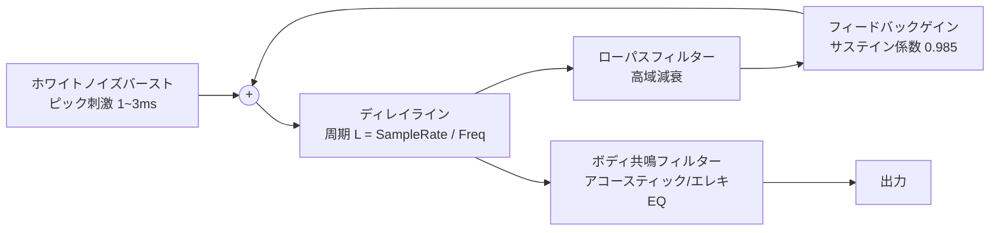

# 🎸 ギター指板Webアプリ（14フレット対応）設計ガイドライン

本ドキュメントは、iPhone・Android・macOS・Windowsのすべての主要ブラウザで動作する、ギター指板発音Webアプリケーションの開発設計ガイドラインです。

---

## 1. プロジェクト基本要件 & コンセプト

### 1.1 背景とゴール
- **GarageBandの優れた直感性と視認性を踏襲**: GarageBandのギター指板UIをリスペクトし、リアルで美しいストラトキャスター／フェンダースタイルの指板を再現。
- **14フレットフルサイズ表示**: GarageBand（13フレット制限）を超え、**0フレット（開放弦）〜 14フレットまで**の全領域をフルサイズで表示・演奏可能。
- **マルチプラットフォーム完全対応**: iPhone (iOS Safari), Android (Chrome), macOS (Safari/Chrome), Windows (Edge/Chrome) で完全動作。
- **ブラウザ1本（No Build / Zero Dependency）**: 外部ライブラリや重いフレームワークに依存せず、HTML/CSS/JavaScript単体で軽量・高速に動作。

---

## 2. システムアーキテクチャ & 技術スタック

```mermaid
graph TD
    User[ユーザー操作: マウス/マルチタッチ] --> PointerHandler[Pointer Events Controller]
    PointerHandler --> VisualEngine[UI / アニメーション描画エンジン]
    PointerHandler --> AudioEngine[Web Audio API エンジン]
    
    subgraph UI層
        VisualEngine --> Fretboard[ストラト風 14フレット指板 (CSS/SVG)]
        VisualEngine --> TouchMarker[● 押弦マーカー & 弦振動エフェクト]
        VisualEngine --> NoteBadge[音名バッジ (C, D, E... / ドレミ)]
    end

    subgraph 音響層 (Web Audio API)
        AudioEngine --> AudioCtx[AudioContext (iOS自動再生解除管理)]
        AudioEngine --> KarplusStrong[Karplus-Strong 撥弦物理合成]
        KarplusStrong --> StringFilter[弦減衰ローパス + キャビネットEQ]
        StringFilter --> MasterGain[マスターボリューム / パン]
        MasterGain --> Destination[スピーカー / イヤホン]
    end
```

### 2.1 技術選定
| 区分 | 採用技術 | 選定理由 |
| :--- | :--- | :--- |
| **マークアップ** | セマンティック HTML5 | 単一ファイル（または最小限のファイル構成）でポータビリティを最大化 |
| **スタイリング** | Vanilla CSS3 (Custom Properties + Flex/Grid) | ネイティブGPUアクセラレーション、木目・金属感の高精細表現、レスポンシブ配置 |
| **ロジック** | Vanilla JavaScript (ES2022+) | ビルド不要、低遅延ポインター追跡、軽量・省メモリ |
| **音響** | Web Audio API (Karplus-Strong 合成) | 外部音源ファイルのロード不要、遅延ゼロ、オフライン即座動作 |
| **入力制御** | W3C Pointer Events API | マウス・タッチ・ペン入力を単一APIでシームレスかつ高精度にマルチタッチ処理 |

---

## 3. UI / UX & ビジュアル設計仕様

### 3.1 指板の構造とサイズ比率
- **弦（6本）**:
  - 1弦（最細・最高音: E4）〜 6弦（最太・最低音: E2）
  - 弦ごとに太さ（border-width / height）と金属の巻弦テクスチャ（スパイラル線）を差別化。
- **フレット（14フレット + ナット）**:
  - **ナット（0フレット / 開放弦エリア）**: ヘッドストック側に開放弦専用のタップエリアを確保。
  - **1〜14フレット**: ギター本来の物理的間隔（高フレットほど狭くなる）を対数的に反映しつつ、スマホの画面幅でも14フレットが極端に押しにくくならないよう**視認性と操作性を両立した緩やかなフレット比率**を採用。
- **指板スタイル（ストラトキャスター／フェンダー調）**:
  - **メイプル指板（明るい琥珀色の木目）** または **ローズウッド指板（落ち着いたダークブラウン木目）**（ワンタップで切り替え可能）。
  - **ポジションマーク（ドットインレイ）**:
    - **シングルドット**: 3, 5, 7, 9 フレットの中央
    - **ダブルドット**: 12フレット（オクターブ位置）
  - **フレットワイヤー**: ニッケルシルバー特有の立体的な光沢・シャドウをCSSリニアグラデーションでリアルに表現。

### 3.2 押弦フィードバック表示（● マーカー）
- 押さえたフレット位置（弦とフレットの交点）に、**光彩（グロー）を帯びた「●」マーカー**を瞬時に描画。
- **音名表示**: 「●」の中または上部に音名（例: `E2`, `A2`, `C#3` 等）を視認性高く表示（設定で音名ON/OFF、英語表記／階名表記を切り替え可能）。
- **弦の振動アニメーション**: 押弦時に該当弦が微細に縦振動するアニメーション（CSS Keyframe）を適用し、リアルな弾き心地を提供。

---

## 4. 音声エンジン設計（Web Audio API）

### 4.1 音源方式：Karplus-Strong 物理モデリング合成
外部のWAV/MP3ファイルをダウンロードすることなく、ギター弦の物理的な振動と減衰をアルゴリズムでリアルタイム生成します。



#### 音高（周波数）計算式
スタンダードチューニング（EADGBE）を基準とし、弦インデックス $s$ とフレット番号 $f$ からMIDIノート番号および周波数を動的算出：
$$MIDI = BaseNote[s] + f$$
$$Frequency = 440 \times 2^{\frac{MIDI - 69}{12}}$$

- **6弦**: E2 (40) = 82.41 Hz
- **5弦**: A2 (45) = 110.00 Hz
- **4弦**: D3 (50) = 146.83 Hz
- **3弦**: G3 (55) = 196.00 Hz
- **2弦**: B3 (59) = 246.94 Hz
- **1弦**: E4 (64) = 329.63 Hz
- **1弦14フレット**: F#5 (78) = 739.99 Hz

### 4.2 iOS Safari / Androidの音声自動再生制限対策
- iOS/Safariではユーザーの明示的なジェスチャー（タップ・クリック）がないと `AudioContext` が `suspended` 状態になります。
- **初回タップ検知時に自動で `audioCtx.resume()` を呼び出すアンロック機構**を内包し、ユーザーにストレスを与えないシームレスな発音開始を実現。

---

## 5. マルチプラットフォーム & レスポンシブ設計

### 5.1 画面の向き（Orientation）方針
- **スマートフォン（iPhone / Android）**:
  - **横画面（Landscape）を完全推奨**。
  - 端末が縦向き（Portrait）の場合:
    「🎸 端末を横向きに回転してください」というエレガントな案内オーバーレイを自動表示。
  - 横向きになった瞬間に、画面全幅いっぱいに0〜14フレットを展開。
- **PC（macOS / Windows） & タブレット（iPad）**:
  - ウィンドウ幅に応じてアスペクト比を保ちつつ、指板全体が常に画面中央に最適表示されるレイアウト。

### 5.2 操作性と誤動作防止
- `touch-action: none;`: 指板エリアでのピンチズームやページ全体の不要なスクロールを無効化。
- `user-select: none;`: 長押し時のテキスト選択や画像保存ポップアップを完全抑止。
- `pointerId` 追跡: 最大10本の指による同時打鍵（ポリフォニック・和音演奏）を追跡。
- **スライド・ストローク奏法**:
  - 指を押したまま弦を縦にスワイプした際、触れた弦が次々と鳴る「ストローク（ストラミング）」演奏に対応。

---

## 6. 実装ファイル構成（ミニマル設計）

ビルドツールを必要とせず、そのままダブルクリックやWebサーバー配置で動作するシンプルな構成：

```
bandgarage/
├── index.html        # アプリ構造、開放弦/フレット配置、オーバーレイ
├── style.css         # ストラト風木目デザイン、フレット、弦、レスポンシブ、アニメーション
└── app.js            # Web Audio音響エンジン、PointerEvents、状態管理
```

---

## 7. 実装ステップとマイルストーン

1. **フェーズ1: コア構造 & Web Audioエンジン構築**
   - 6弦 × 14フレット（+開放弦）のグリッド定義
   - Karplus-Strong音響合成エンジン実装（全音域の低遅延発音テスト）
   - iOS AudioContextロック解除ロジック
2. **フェーズ2: フェンダースタイル指板UI & ●フィードバック**
   - メイプル / ローズウッドのリアルな木目CSS
   - ドットインレイ（3, 5, 7, 9, 12フレット）配置
   - 押弦時の「●」マーカー表示と弦振動アニメーション
3. **フェーズ3: マルチデバイス・レスポンシブ最適化**
   - 横画面案内オーバーレイの実装
   - マルチタッチ（和音演奏）およびスライド発音の微調整
   - macOS / Windows / iPhone / Android の実機操作感検証
